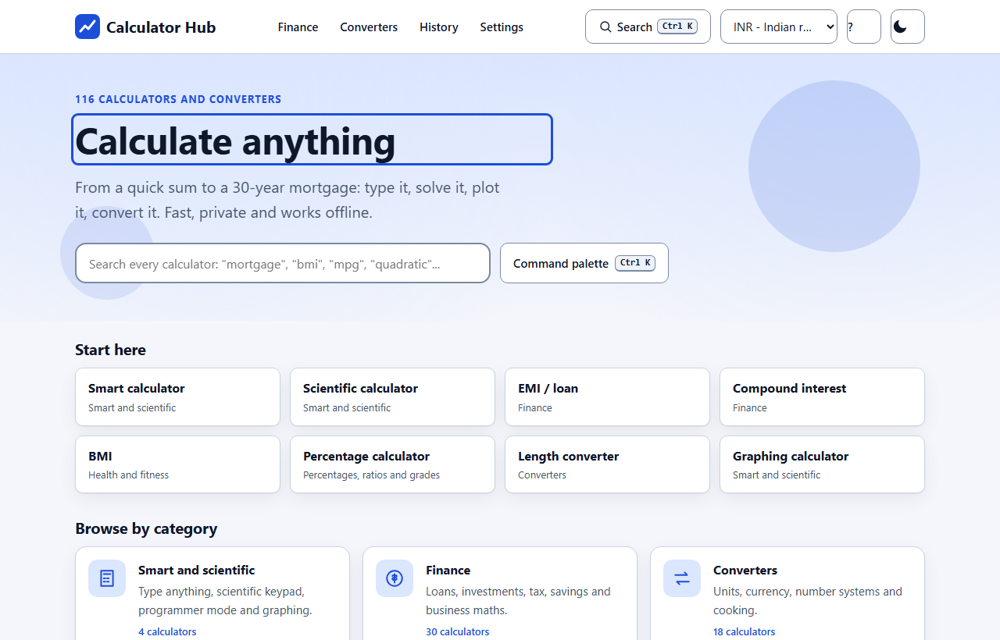
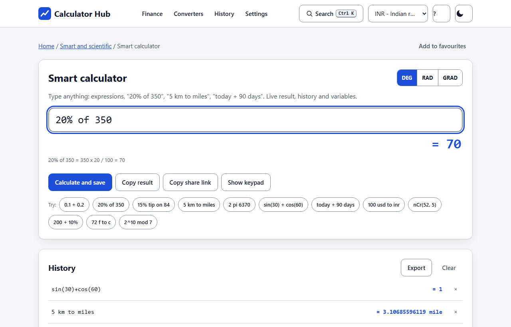
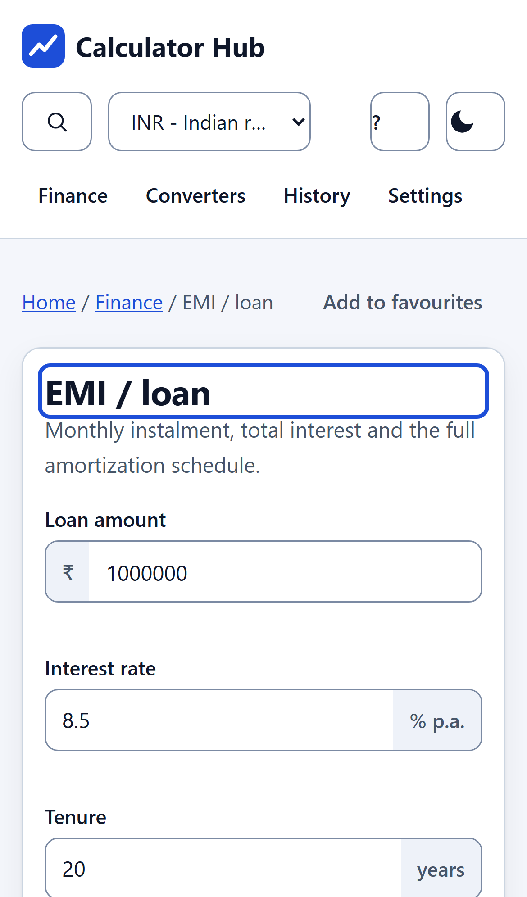
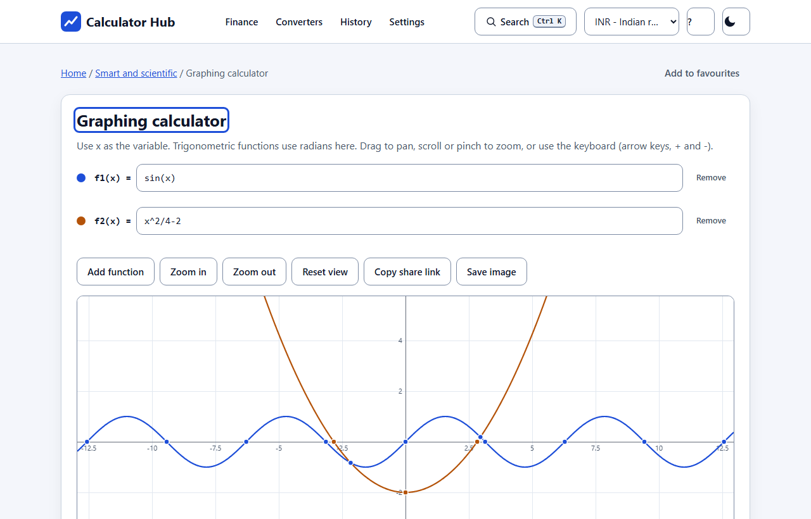

# Calculator Hub (Simple interest calculator)

A calculate-anything web app: a smart calculator that understands plain language, scientific, programmer and graphing modes, equation solvers, statistics, 30 finance tools, health, dates, everyday estimators, science formulas and unit and currency converters. 116 calculators in one static, installable, offline-capable site. No server, no accounts, no tracking.

**Live preview:** https://shishir19999.github.io/Simple-interest-calculator/



## Highlights

- **Smart calculator.** Type `0.1 + 0.2`, `20% of 350`, `15% tip on 84`, `200 + 10%`, `5 km to miles`, `100 usd to inr`, `today + 90 days`, `nCr(52, 5)`, `x = 12` then `x * 2`. Live result, `ans`, variables, history with search and export, arrow-key recall. A real parser (no `eval`) with decimal arithmetic, so money maths has no floating point artefacts.
- **Scientific keypad** with degrees, radians and gradians; **programmer** mode (bin, oct, dec, hex, bitwise operators, 8/16/32/64-bit two's complement, clickable bit grid); **graphing** with up to six functions, pan, zoom (drag, wheel, pinch, keyboard), roots, intercepts, intersections and a table of values.
- **Command palette** (`Ctrl K`, or `/`) searches every calculator; categories, favourites, recently used; keyboard shortcut list (`?`).
- **Shareable state.** Every calculator keeps its inputs in the URL hash: `#/c/emi?p=500000&r=9&t=15`. Copy link, copy result, copy steps, show the working, CSV export of tables and schedules, print stylesheet.
- **Settings:** theme, decimal places, significant digits, angle unit, number format and currency.
- Light and dark themes, subtle parallax hero (off for reduced motion and small screens), responsive from 320 px, keyboard-first, aria-live results, visible focus, custom 404 page.
- **Installable PWA** with an offline service worker. Currency works offline with clearly labelled sample rates and can optionally fetch live reference rates (free, keyless, with graceful fallback).

## Catalogue

| Category | Count | Examples |
| --- | --- | --- |
| Smart and scientific | 4 | smart, scientific, programmer, graphing |
| Finance | 30 | simple and compound interest, EMI with amortization, mortgage with extra payments, loan comparison, affordability, SIP, step-up SIP, FD and RD, lump sum vs SIP, savings goal, PV/FV, NPV and IRR, CAGR, ROI, inflation, rule of 72, retirement, FIRE, withdrawal plan, credit card payoff, break-even, GST/VAT/sales tax, discount, markup and margin, salary and hourly, tip split, depreciation, slab income tax, APR to APY |
| Converters | 18 | length, area, volume, mass, temperature, speed, pressure, energy, power, time, data, angle, fuel economy, force, frequency, cooking, currency (39), number bases |
| Algebra and solvers | 6 | linear, quadratic, cubic, systems of equations, matrices, complex numbers |
| Statistics and probability | 7 | descriptive stats, regression and correlation, normal, binomial, Poisson, permutations and combinations, confidence interval |
| Geometry and trigonometry | 5 | 10 flat shapes, 9 solids, right triangle, coordinate geometry, trig values |
| Number theory | 8 | prime factors, GCD and LCM, fractions, Roman numerals, number to words (also lakh and crore), sequences, rounding, random |
| Health and fitness | 11 | BMI, BMR and TDEE, body fat, ideal weight, heart rate zones, calories burned, water intake, macros, due date, running pace, sleep cycles |
| Date and time | 7 | age, date difference, add or subtract, working days, countdown, time zones, day of the week |
| Percentages, ratios and grades | 5 | all percentage variants, ratio and proportion, averages, GPA, CGPA |
| Everyday and home | 8 | fuel cost, electricity bill, paint, tiles, concrete, download time, unit price, cooking cups to grams |
| Physics and chemistry | 7 | Ohm's law, projectile motion, speed-distance-time, ideal gas, half-life, molar mass, pH |

The research behind this scope, with formulas and accuracy notes, is in [docs/RESEARCH.md](docs/RESEARCH.md).





## Develop

```bash
npm install
npm run dev            # http://localhost:5510
npm test               # unit tests (node:test) for the maths and for every calculator
npm run lint
npm run build          # relative-path build into dist/
npm run build:pages    # build for the GitHub Pages sub-path /Simple-interest-calculator/
npm run preview
```

## Structure

- `src/lib/` pure maths with no DOM: `expr.js` (tokenizer, parser, decimal and double evaluators), `nlq.js` (percentages, units, currency, dates in plain language), `finmath.js` and `finext.js` (finance), `mathx.js` (solvers, matrices, statistics, probability, number theory, geometry), `life.js` (health, everyday, science), `dates.js`, `units.js`, `currency.js`, `progcalc.js`.
- `src/calcs/` declarative calculator definitions (inputs plus a pure `run`) and the registry used by search, routing and tests.
- `src/core/` formatting, input validation and execution, persistent store.
- `src/ui/` the form engine, charts, smart calculator, programmer, graph, converters, pages and the command palette.
- `tests/` reference-value tests (EMI, mortgage, BMI, BMR, statistics, normal distribution, dates, unit round trips and more) plus a smoke test that runs every calculator with its default inputs.

## Accuracy notes

Results are estimates for illustration and are not financial, medical or legal advice. Tax rules, rates and rounding vary by country and provider; the income tax calculator uses slabs you edit. BMI and BMR differ between formulas by up to about 10 percent. Sample currency rates are indicative only.

## Deploying to GitHub Pages

`npm run build:pages` produces `dist/` with the correct base path. Publish the contents of `dist/` to the Pages branch or use a Pages workflow that runs the same command. The service worker and manifest use relative URLs, so the app also works from any other sub-folder when built with `npm run build`.

## Licence

MIT
